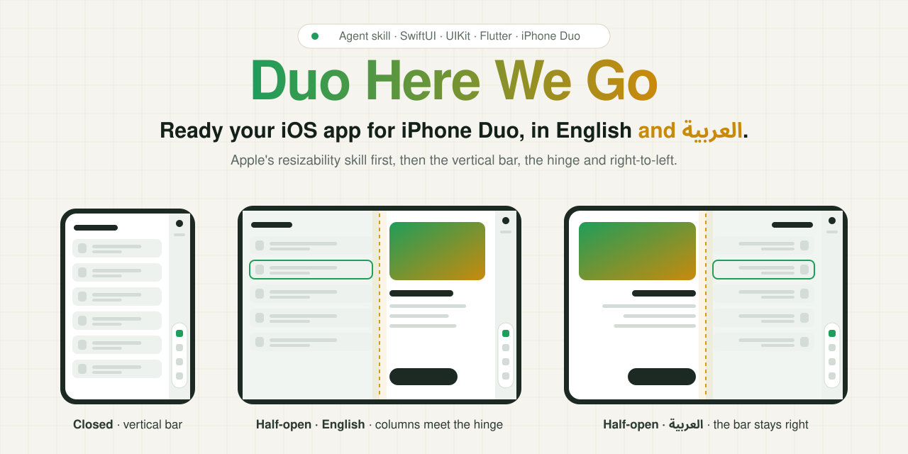
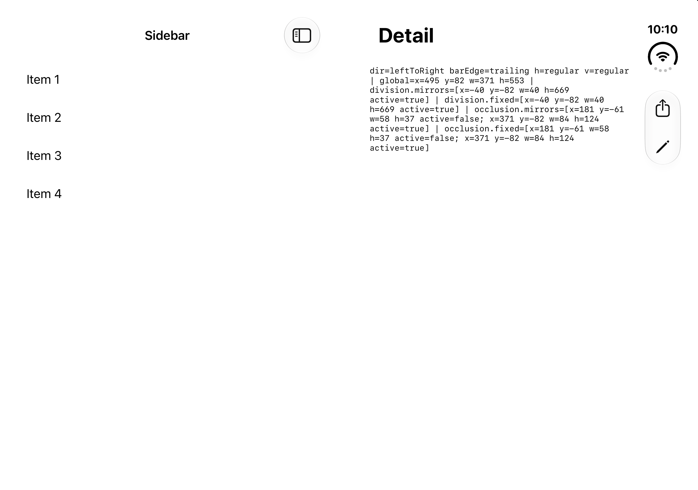
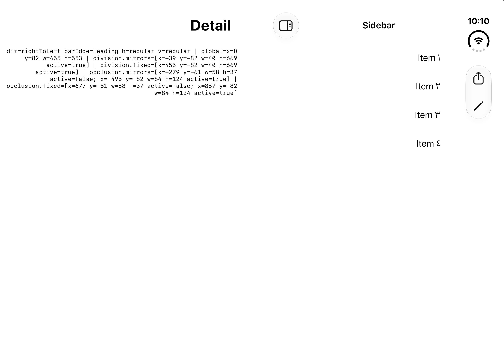
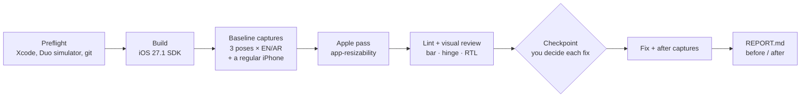

<div align="center">

<picture>
  <source media="(prefers-color-scheme: dark)" srcset="docs/assets/banner-dark.svg" />
  <source media="(prefers-color-scheme: light)" srcset="docs/assets/banner-light.svg" />
  
</picture>

# Duo Here We Go

**Ready your SwiftUI, UIKit or Flutter app for iPhone Duo, in English and Arabic.**

<p dir="rtl"><b>جهّز تطبيقك لـ iPhone Duo بالعربي والإنجليزي.</b></p>

[](LICENSE)
[](#requirements)
[](#flutter)
[](#install)
[](#install)
[](#why-iphone-duo-needs-its-own-pass)

</div>

---

## Why iPhone Duo needs its own pass

iPhone Duo folds. The closed outer display is compact; open, the inner display is wide; half-open, a hinge runs down the middle. The system bars move into a **vertical bar** on the side. Apple's `app-resizability` skill (in Xcode 27.1) handles the resizable-window basics. These are the things it leaves, measured on the iPhone Duo simulator:

| | What happens | Measured |
|---|---|---|
| **Vertical bar** | Status items and your toolbar move into a column on the physical right | 84 pt of the 951 pt inner display |
| **Hinge** | A `division` reserved region splits the display when partially open | x = 455–495 pt |
| **Unequal halves** | The hinge splits the whole display, so the half with the bar is narrower | 455 pt vs 371 pt |
| **Capped sidebars** | A split view only snaps to the hinge if the sidebar may grow past the hinge centre | max width > 475 pt |
| **Arabic** | The bar stays on the right; `toolbarVerticalEdge` flips from `trailing` to `leading`; the sidebar moves beside the bar, into the narrow half | every pose |
| **In-app language switch** | Forcing RTL through `UIView.appearance()` leaves the bar on the wrong side and an empty strip on the left | 88 pt (Apple forum 852870) |
| **Two coordinate systems** | `UIView.reservedRegions` is physical; SwiftUI's defaults to `.mirrors` | x = 455 vs 371 in Arabic |
| **Flutter** | The column is only a right safe-area inset and the fold never arrives, so lists slide under the clock (titles, in Arabic) and dialogs cross the hinge | 84 pt, every pose |

Nothing else in this space checks the right-to-left side. Duo Here We Go treats Arabic as a first-class pose.

<details>
<summary><b>See it on the simulator</b>: half-open, English and Arabic</summary>
<br>

| English | العربية |
|---|---|
|  |  |

Raw captures from the probe app in `research/rtl-probe`, with the values it logs printed on screen.

</details>

## How it works



1. **Preflight** checks Xcode 27.1, finds or creates the iPhone Duo simulator, and keeps its scratch folder out of git.
2. **Build** for the Duo simulator with the iOS 27.1 SDK, the one that moves the bars to the side.
3. **Capture** closed, open (180°) and half-open (90°), in English and Arabic, plus the same screens on a regular iPhone to tell Duo problems from app problems. The hinge is driven for you.
4. **Apple pass** runs Apple's own skill, exported from your Xcode and never bundled.
5. **Lint and review**: static rules for the bar, the hinge and RTL, then every Arabic shot against its English twin and every half-open shot against the hinge band.
6. **Checkpoint**: it stops and shows you each finding with the fix it proposes. Nothing changes until you say yes.
7. **Fix and capture again**, then one **REPORT.md** with a readiness line, the findings, a before/after screen grid and an honest *Not verified* list.
8. **App Store screenshots**, only if you ask: the after shots, in each language, at the iPhone Duo sizes App Store Connect takes, ready for you to upload.

## What it catches

| Rule | Severity | Catches |
|---|---|---|
| `DHWG-001` | warn | A split-view sidebar capped at or below 475 pt, so half-open the detail runs across the fold |
| `DHWG-002` | warn | User-facing text that names Face ID; iPhone Duo has Touch ID only |
| `DHWG-FL-001` | warn | Flutter fold logic on `displayFeatures`, which is always empty on iOS without a bridge package |
| `DHWG-FL-002` | warn | A portrait-only orientation lock in a Flutter app |
| `DHWG-FL-003` | error | `UIRequiresFullScreen` in a Flutter app's `Info.plist`, so iOS scales it into a portrait window |
| `DHWG-FL-004` | warn | A dropped right safe-area inset, so content runs under the 84 pt system column |
| `DHWG-RTL-006` | warn | A physical inset in `EdgeInsetsDirectional`, which moves the column's gap to the left in Arabic |
| `DHWG-RTL-001` | error | In-app RTL through the appearance proxy without `traitOverrides.layoutDirection` |
| `DHWG-RTL-002` | warn | UIKit (physical) and SwiftUI (mirrored) reserved-region frames mixed in one project |
| `DHWG-RTL-003` | warn | The vertical bar edge mapped to `left`/`right` instead of leading/trailing |
| `DHWG-RTL-004` | info | Fixed sidebar or arrangement widths that swap halves in Arabic |
| `DHWG-RTL-005` | warn | The appearance-proxy switch in a project with SwiftUI views, which ignore it |

### Flutter

Flutter draws its own bars and gets no fold on iOS, so it has its own rules and review checklist in [`references/flutter.md`](skills/duo-here-we-go/references/flutter.md). The skill builds with `flutter build ios --simulator`, captures and reports the same way, and keeps Arabic first. For the layout work itself (side-column navigation, list/detail, the fold layer) it points you to [duo-adapt](https://github.com/islam-diab/duo-adapt), which you install separately. Measured with Flutter 3.47.9 on the simulator: the column arrives as an 84 pt right inset in every pose and language, `displayFeatures` stays empty half-open so dialogs cross the hinge, and in Arabic a list's titles slide under the clock (`research/flutter-probe`).

Plus visual findings from the captures, and Apple's own findings, in the same report. Suppress a finding in code with a reason: `// dhwg:disable-next-line DHWG-RTL-001 -- why`.

## Install

Pick one way. Using two installs the skill twice in the same agent.

**Every agent on your Mac** (Claude Code, Codex, Cursor, OpenCode, Gemini CLI, Antigravity and more):

```bash
npx skills add 7aggag/Duo-here-we-go -g --agent '*' -y
```

Or only the agents you name:

```bash
npx skills add 7aggag/Duo-here-we-go -g -a claude-code -a cursor -a codex -a opencode -y
```

**Without Node:** clone once and link the skill where agents look for it.

```bash
git clone https://github.com/7aggag/Duo-here-we-go.git ~/.duo-here-we-go && mkdir -p ~/.agents/skills ~/.claude/skills && ln -sfn ~/.duo-here-we-go/skills/duo-here-we-go ~/.agents/skills/duo-here-we-go && ln -sfn ~/.duo-here-we-go/skills/duo-here-we-go ~/.claude/skills/duo-here-we-go
```

**Claude Code plugin:**

```bash
claude plugin marketplace add 7aggag/Duo-here-we-go
claude plugin install duo-here-we-go@duo-here-we-go
```

## Use

Open your agent in the app's folder and ask:

> Get this app ready for iPhone Duo.

Or in Arabic: *جهّز التطبيق ده عشان يشتغل كويس على iPhone Duo*. The agent answers in the language you write in. Everything it produces lands in `dhwg-out/`, with `REPORT.md` on top.

### App Store screenshots

When the app is ready, ask for its store screenshots:

> Make the iPhone Duo App Store screenshots, in English and Arabic.

Or in Arabic: *صوّر صور المتجر للـ Duo بس بالعربي والإنجليزي*. Asked for screenshots only, the agent skips the review and the fixes: it builds, captures the screens you pick and writes the store folders.

App Store Connect takes iPhone Duo screenshots at 1398 × 2034 (outer display) and 2007 × 2853 (inner display), and [shows a badge](https://developer.apple.com/help/app-store-connect/reference/app-information/screenshot-specifications/) on the product page when they are there. The skill captures the screens you pick in every pose and language, keeps the shots at those sizes, removes the alpha channel App Store Connect rejects, and writes up to 10 per language to `dhwg-out/store/<lang>/`. The Arabic ones are captured in Arabic, never mirrored from English, because the bar does not move. Each folder is one set: App Store Connect keeps a single iPhone Duo set per language that takes both sizes together, up to 10. It adds no titles or frames and uploads nothing: you add each folder under iPhone Duo in that language's Media Manager.

## Requirements

- macOS with Xcode 27.1 or later. The skill creates the iPhone Duo simulator, and downloads its runtime (~8 GB) only after asking you. From Xcode 27.2 the Duo has its own runtime, separate from the other iPhones'; the skill picks the right one.
- For Flutter apps: Flutter 3.41 or later.
- Python 3.9 or later (the one that ships with Xcode's command line tools works).
- An agent that can run terminal commands. The visual review needs a model that reads images.
- A git repository, so every change is reviewable.

## What it runs and changes

- **Reads** your sources, `Info.plist` and build settings, and `git status`.
- **Changes** your code only after you say yes at a checkpoint, and leaves every change uncommitted for you to review. It never commits or pushes.
- **Writes** its captures, findings and report to `dhwg-out/`, which it adds to your repo's local `.git/info/exclude`.
- **Runs** `xcodebuild` (or `flutter build ios` for Flutter apps), `xcrun simctl`, `xcrun agent skills export` (Apple's skill, into a temp folder), its own Python scripts, and the bundled `hinge` helper, which runs inside the simulator only.
- **Network:** only Apple's simulator runtime download, and only if it is missing and you agree. For a Flutter app, `flutter build` may also fetch the app's own packages from pub.dev.
- **Data:** it collects nothing and sends nothing anywhere.

## What's inside

```text
skills/duo-here-we-go/
  SKILL.md               the eight steps the agent follows, plus App Store screenshots
  references/            Apple bridge, RTL rules, iPhone Duo layout rules, Flutter rules, API cheat sheet
  scripts/               preflight, simulator setup, capture, lint, report, store screenshots (Python, standard library)
  vendor/hinge/          the hinge CLI that drives the simulator's fold
.claude-plugin/          Claude Code plugin and marketplace manifests
research/rtl-probe/      the probe apps and captures behind the RTL rules
research/flutter-probe/  the Flutter probe and captures behind the Flutter rules
docs/                    architecture, research, banner source
tests/                   python3 -m unittest discover -s tests
```

## Status

Built in November 2026, right after iPhone Duo shipped, and already run on three real apps: SwiftUI, UIKit with a login flow, and a large SwiftUI app with Firebase. Flutter support is measured on a probe app with Flutter 3.47.9 and has not run on a real Flutter app yet. Every value comes from the Xcode 27.1 iPhone Duo simulator. Reports from real devices are welcome; open an issue with what you measured.

## Credits

- [`hinge`](https://github.com/artemnovichkov/hinge) by Artem Novichkov (MIT) drives the simulator's fold.
- Apple's `app-resizability` skill runs from your own Xcode; it is not included here.
- [duo-adapt](https://github.com/islam-diab/duo-adapt) (MIT) and Bilal Aksoy's write-up pointed at the Flutter behaviour that `research/flutter-probe` then measured; the fold status is tracked in flutter/flutter#192515.
- The in-app language bug was first reported on the Apple Developer Forums, thread 852870.

## License

[MIT](LICENSE). iPhone and iPhone Duo are trademarks of Apple Inc. This project is not affiliated with Apple.
